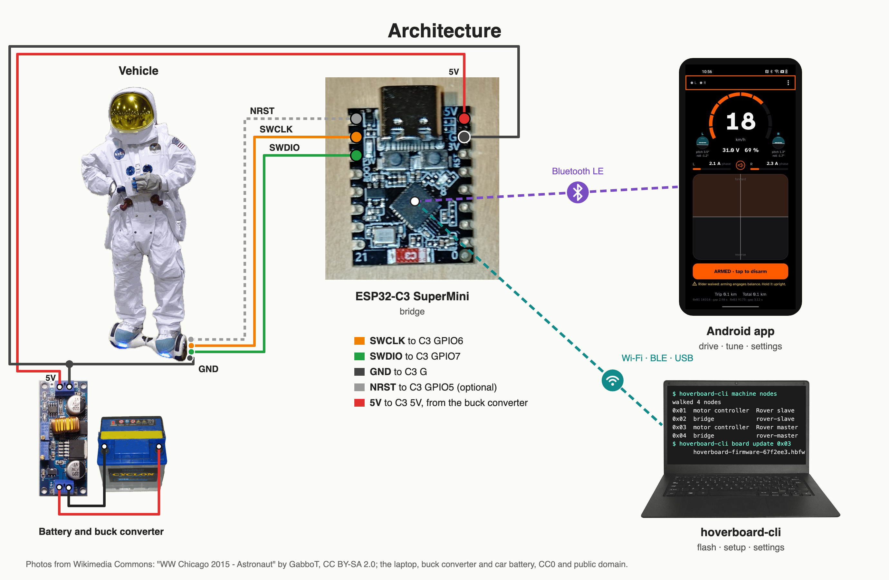

# hoverboard-firmware

**A configurable firmware for vehicles and robots built on hoverboard motor controllers.** It runs on
the single board that drives both wheels (the board
[EFeru's FOC firmware](https://github.com/EFeru/hoverboard-firmware-hack-FOC) targets) and on the
split boards, one per wheel ([RoboDurden's Gen2](https://github.com/RoboDurden/Hoverboard-Firmware-Hack-Gen2.x)).

> ⚠️ This firmware switches the motor controller's FETs directly. A bug in commutation, dead-time or the
> fault and arming logic can cause [shoot-through](https://en.wikipedia.org/wiki/H-bridge#General): both
> FETs of a phase leg turn on at once and short the battery. Bring a new board up on a current-limited
> bench supply before it sees a battery. Use it at your own risk: the firmware comes with no warranty.

- **The board is configured, not compiled.** Other hoverboard firmware projects compile the board in
  through `#define`s, per-board headers or an online build generator. Here the board layout, the
  IMU, the drive mode and the tuning are settings stored on the board. You change them without
  rebuilding or reflashing.
- **Settings decide what the vehicle is:** a balancing hoverboard, a kart, a scooter or a robot base.
- **FOC, sine and six-step commutation are all in the image.** A setting picks one.
- **`hoverboard-cli` does the host side.** It flashes boards and bridges, edits settings and drives
  the wheels.
- **Flashing needs no debug probe.** Each board is flashed over Wi-Fi through an ESP32-C3 bridge on
  its SWD header.
- **An Android app drives and tunes over Bluetooth** through the same bridge.
- **One bundle file holds every image.** `hoverboard-cli` picks the right one for each chip.

## Commutation

The image has the three methods of EFeru's FOC firmware, checked on the host against behaviour
recorded from the stock firmware:

- **Six-step** (trapezoidal). It needs no current sensor.
- **Sine**, open loop. It needs no current sensor.
- **FOC**, closed loop on a q-axis current reference. It needs a current sensor.

`machine.method` selects the method. FOC on a board without current sensing falls back to six-step
and raises a fault flag. The board reports the method it actually runs.

## Configuration

A board's layout cannot be detected: which pins drive the phases, where the halls, IMU, buttons and
LEDs sit, which IMU is fitted, and whether the board drives one wheel or two. This firmware stores it
on the board with the tuning.

- **The store** is a log of key/value records in flash, each with its own CRC. The newest record for
  a key wins, and a missing key reads its default. A blank or corrupt store reads as defaults, and a
  torn write loses only the record being written.
- **Settings change over the board's link** (Bluetooth, UART or SWD). The board refuses writes while
  armed. A change takes effect at the next arm.

## Documentation

- [Getting started](docs/getting-started.md): from a stock motor controller to driving.
- [hoverboard-cli reference](docs/cli-reference.md): every command.
- [Building](docs/building.md): build the images, the CLI and the app, and run the tests.
- [Board files](boards/README.md): the layouts in `boards/` and how to apply one.

## Licence

GPL-3.0-or-later; see [LICENSE](LICENSE). `third_party/gd32-spl/` holds GigaDevice's peripheral
library and ARM's CMSIS headers under BSD-3-Clause
([third_party/gd32-spl/LICENSE](third_party/gd32-spl/LICENSE)). Only the golden-trace harness
compiles it; the firmware does not link it.

## Prior art

- [NiklasFauth/hoverboard-firmware-hack](https://github.com/NiklasFauth/hoverboard-firmware-hack):
  the original hack, with six-step commutation.
- [EFeru/hoverboard-firmware-hack-FOC](https://github.com/EFeru/hoverboard-firmware-hack-FOC): the FOC
  firmware most projects build on.
- [RoboDurden/hoverboard-firmware-hack-FOC](https://github.com/RoboDurden/hoverboard-firmware-hack-FOC):
  forks of it with per-board defines and an [online config generator](https://pionierland.de/hoverhack/).

## Status

✅ working on hardware &nbsp; 🚧 in progress &nbsp; 📋 planned &nbsp; ❌ abandoned

| Component | | What it does |
|---|:--:|---|
| HAL (`motorcontroller/hal`) | ✅ | GPIO, USART with DMA, timers, ADC, I2C, SPI and flash on the GD32F103C8, GD32F130C8 and GD32F103RC, each register sequence checked against GigaDevice's library |
| Config store (`shared/store`) | ✅ | keeps the settings in flash |
| Firmware image (`motorcontroller/firmware`) | ✅ | reads the board layout, mounts the store, and runs the 250 Hz control loop and the 16 kHz motor interrupt |
| Board model | ✅ | reads the pin map from the settings at boot and checks it against the chip; it refuses a layout that would drive the wrong pin |
| Link stack (`shared/link`, `shared/net`) | ✅ | carries framing, addressing, discovery, forwarding and the settings protocol over the inter-board UART, Bluetooth and SWD |
| Safety | ✅ | the mode machine, fault latches, and an arming gate that is the only path to energizing the motor bridge |
| Motor control | ✅ | six-step, sine and FOC torque mode, with a phase-current limit, an over-current trip and hall-loss faults |
| Single board, dual motor | ✅ | the GD32F103RC board drives both motors from one image |
| Optional protections | ✅ | a per-motor peak trip, and on the single board the DC-link limit and the timer break input |
| IMU and attitude | ✅ | a configurable I2C IMU driver and a pitch and roll filter |
| Balance control | ✅ | a state-feedback controller tuned live from the phone; a rigid-frame rover balances on it and has been ridden outdoors |
| Foot pads | 🚧 | the pad inputs work; no physical pads are wired yet |
| Tones | ✅ | the buzzer plays the horn and the battery alarms |
| Android app (`apps/remote`) | ✅ | arms, drives, tunes the gains, sounds the horn and sets up boards |
| CLI (`tools/hoverboard-cli`) | ✅ | flashes boards and bridges, reads and writes settings, and drives the wheels, over Wi-Fi, Bluetooth or USB |
| Hoverboard bridge (`bridge/`) | ✅ | an ESP32-C3 on the SWD header: Bluetooth for the phone, Wi-Fi and USB for the CLI, and the flashing path |
| Provisioning and auto-detect | 📋 | a fresh board finds its link and is configured over it |
| ~~Onboard Bluetooth (CC2541)~~ | ❌ | removed; the bridge's Bluetooth replaces it |
| ~~Full configurator~~ | ❌ | replaced by the CLI |
